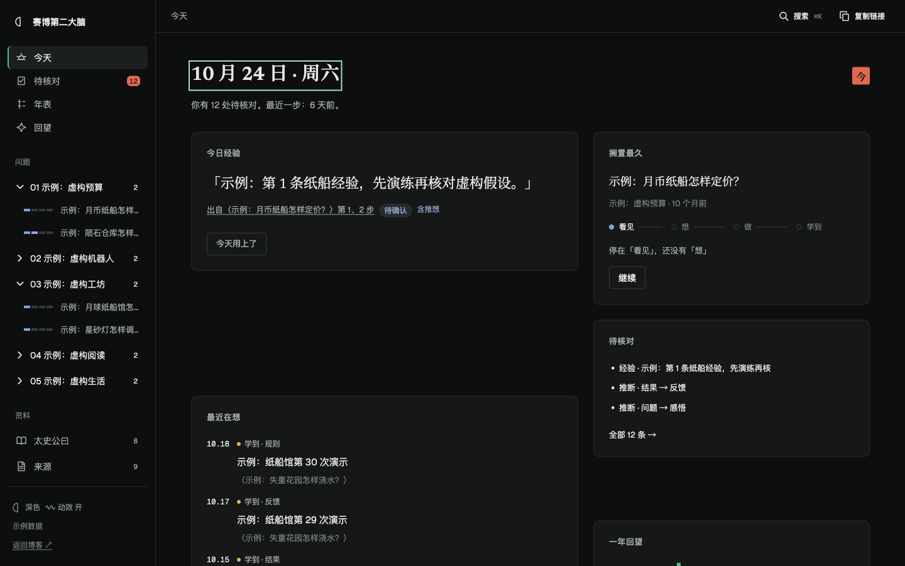
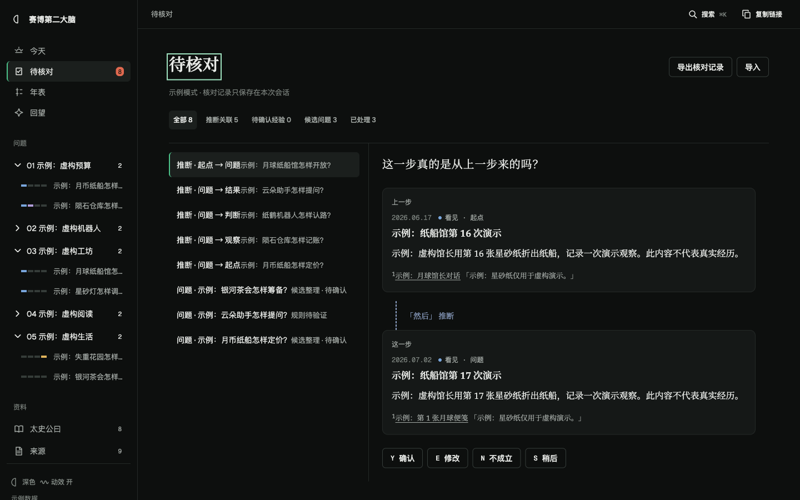
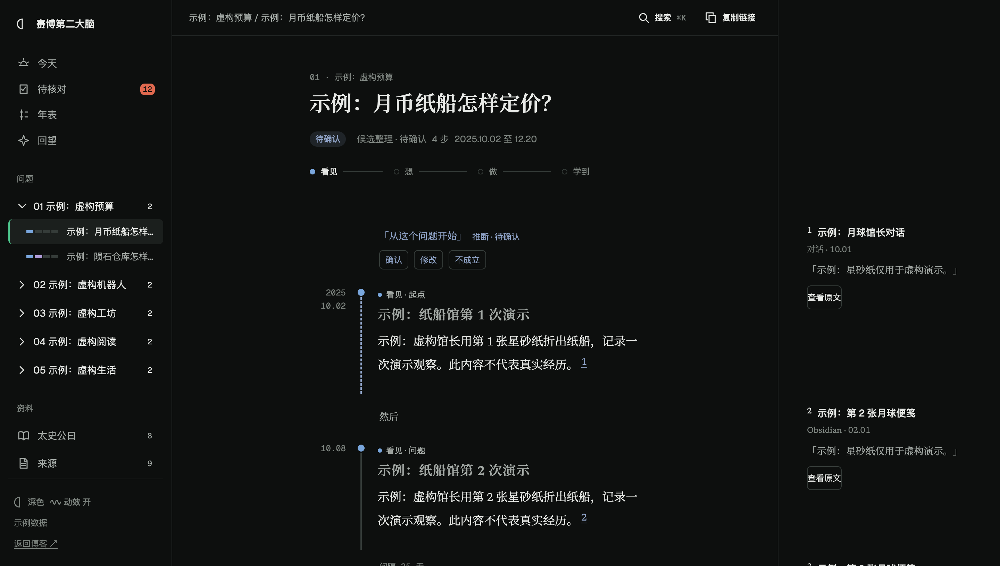

<p align="center"></p>

<p align="center">
  <a href="#简介">简介</a> · <a href="#界面">界面</a> · <a href="#本地运行">本地运行</a> · <a href="#测试">测试</a> · <a href="#数据边界">数据边界</a>
</p>

## 简介

**赛博第二大脑（Cyber 2nd Brain）v3** 是一张每天打开 5 分钟的思考工作台。它帮你核对推断、回看依据、沉淀经验；读起来像一本排版考究的书，偶尔，它能把一年的思考在星空里重放一遍。

产品结构对应三件事：

- **今天**：每天一屏，今日经验、待核对、搁置最久、最近在想、一年回望。
- **待核对**：把「推断」逐条确认、修改、否掉或稍后，核对结果只叠加，不改写原始记录。
- **问题页**：宋体排印的思考轨迹，页边注式来源，「太史公曰」经验集与年表；「回望」以星空重放全部步骤。

## 界面

> 以下截图全部使用虚构的示例数据，不含真实笔记。

### 今天与待核对

<p align="center"></p>
<p align="center"></p>

### 问题页

<p align="center"></p>

### 回望

<p align="center"></p>

## 本地运行

需要 Python 3，无构建步骤、无依赖安装：

```bash
python3 -m http.server 8765 --bind 127.0.0.1
```

打开 [http://127.0.0.1:8765/](http://127.0.0.1:8765/)。

有本地数据时从 `private-data/` 的三个脚本读取；没有时自动切换到 `src/data/sample-data.js` 的示例数据，侧栏底部显示「示例数据」，核对记录只保存在本次会话。

## 测试

```bash
node --test scripts/
```

全部用 Node 内置 `node:test`，零依赖，只使用示例或合成数据。另可选：

```bash
node scripts/check-model.mjs            # 示例数据统计
node scripts/check-model.mjs --private  # 显式读取本地数据，仅仓库所有者使用
```

## 数据边界

**仓库只放示例数据。** 真实笔记保存在本地 `private-data/`，由 `.gitignore` 排除，不入库、不部署。README 与展示素材仅使用虚构内容，不包含真实笔记、密码、密钥或存储配置。

## 文档

- [实现指导](docs/v3-build-guide.md)：v3 的数值、文案、结构以此为准。
- [决策记录](docs/decisions-log.md)：文档未覆盖时的执行选择。
- [产品方向](PRD.md)、[当前界面约定](current.md)。
- `legacy/` 为旧版应用，只读参考，不再修改。

---

<p align="center"></p>
