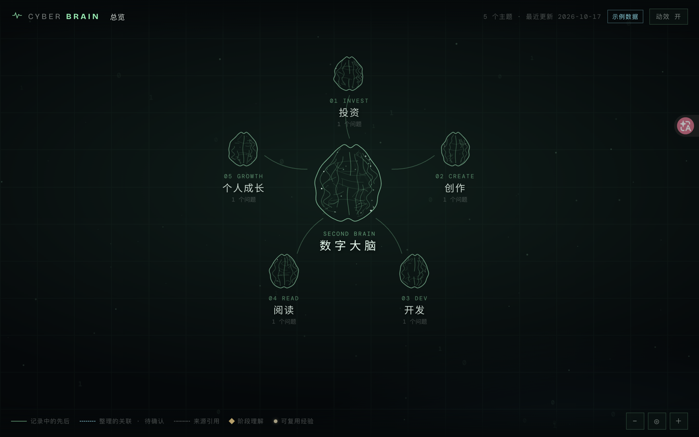
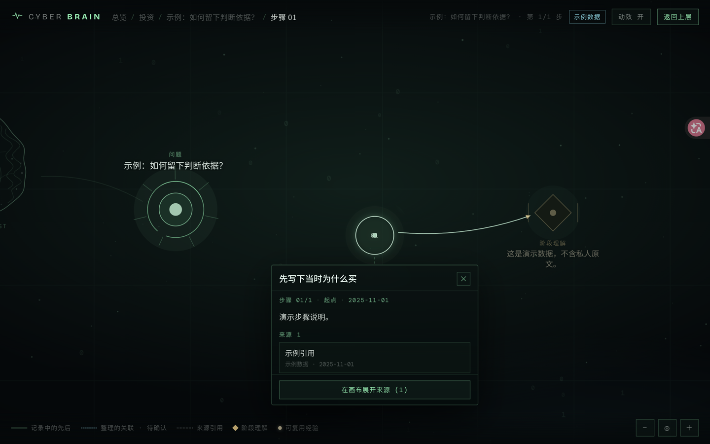

<p align="center"></p>

<p align="center">
  <a href="#简介">简介</a> · <a href="#知识脉络">知识脉络</a> · <a href="#界面">界面</a> · <a href="#本地使用">本地使用</a> · <a href="#数据边界">数据边界</a>
</p>

## 简介

**赛博第二大脑（Cyber 2nd Brain）**是一个个人知识可视化原型。投资、创作、开发、阅读、个人成长，五个主题汇入一张可逐层展开的画布，从问题走进思考步骤，再沿来源回看依据。

画布中的另一条线索是经验星空：天秤座的主星对应行为模式，小星对应可复用经验。点击星点，打开“太史公曰”式的结论卡片，再循着出处回到具体的思考步骤。

让保存过的知识重新参与理解与判断，是这个项目的方向。当前页面用于浏览已整理的数据；产品目标与后续设想见 [PRD.md](PRD.md)，当前界面约定见 [current.md](current.md)。

## 知识脉络

**主题 → 问题 → 步骤链 → 来源**，在画布上就地展开；经验星空提供从经验回到思考过程的另一条入口。

<table>
  <thead>
    <tr><th>入口 / 层级</th><th>可以看到什么</th><th>实现依据</th></tr>
  </thead>
  <tbody>
    <tr><td>五个主题</td><td>投资、创作、开发、阅读、个人成长。点击主题，展开该主题下的问题。</td><td><a href="src/sample-data.js">sample-data.js</a> · <a href="src/app.js">app.js</a></td></tr>
    <tr><td>问题</td><td>围绕具体问题组织思考。点击展开步骤主线，再次点击可查看摘要、状态与步骤数量。</td><td><a href="src/graph.js">graph.js</a> · <a href="src/app.js">app.js</a></td></tr>
    <tr><td>步骤链</td><td>按数据中的顺序串联思考步骤。点击步骤，高亮到该步的路径，查看说明、日期与来源入口；有摘要时，链末呈现阶段理解。</td><td><a href="src/graph.js">graph.js</a> · <a href="src/layout.js">layout.js</a> · <a href="src/app.js">app.js</a></td></tr>
    <tr><td>来源</td><td>在步骤旁展开来源节点，或从浮框进入原文，再返回步骤说明。缺失的来源会明确提示。</td><td><a href="src/graph.js">graph.js</a> · <a href="src/app.js">app.js</a> · <a href="src/popover.js">popover.js</a></td></tr>
    <tr><td>经验星空</td><td>主星呈现行为模式，小星呈现经验卡片；有匹配出处时，可从经验进入关联步骤。需要经验数据，缺少时不显示星空。</td><td><a href="src/stars.js">stars.js</a> · <a href="src/app.js">app.js</a></td></tr>
  </tbody>
</table>

画布支持缩放、平移与复位，主题、问题与步骤的浏览位置可通过地址栏链接定位。

- **浮框**：高度随内容自适应，可整体拖动。内容不多时一次显示完；超出画布可用高度时在框内滚动，头部与「在画布展开来源」等操作按钮钉在底部。
- **悬停邻域高亮**：鼠标悬停约 120ms 后，节点与一跳邻居保持亮度，其余节点和连线淡至 0.25 透明度，200ms 过渡；点击选中优先，触屏不触发。
- **聚焦模式**：有可聚焦路径时按 F，只保留当前路径，其余淡至约 0.1 透明度；Esc 退出，总览层无效，结论节点留在路径上。
- **复制视角链接**：右上角「复制链接」复制当前 URL（含 hash），成功后按钮短暂显示「已复制」；剪贴板不可用时回退到只读输入框。链接不含笔记正文。
- **弧线连线**：步骤与来源连线采用轻微二次贝塞尔弧，流光与生长描线沿同一 path；减少动效时与原直线版本行为一致，不增加额外动画。
- **两跳关联**：步骤浮框列出引用过同一条来源的其他问题，按共同来源条数排序，最多 5 条；当前问题不出现，点一条即可跳过去。
- **叠读**：从步骤浮框点开来源时，原来的浮框收成窄卡压在下面，可逐张点回去或按 Esc 逐级回退，退完最后一张才关闭。
- **每日一星**：经验星空里每天用固定种子挑出一颗经验星，缓慢发出绿色脉冲，点击照常打开经验卡片；同一天挑中的是同一颗，换一天可能不同。
- **展开动画**：展开主题或问题时，新出现的连线与节点由小到大长出来，依次错开；关闭动效时直接到位。
- **中心呼吸**：画布中心随最近一步思考的新旧缓慢明暗，3 天内最亮、30 天以上最暗，6 秒一个呼吸周期；关闭动效时亮度保持静止。
- **毛玻璃浮框**：浮框、窄卡与卡片统一为磨砂玻璃底，模糊背后的画布；不支持模糊的浏览器退回不透明底色，保证文字可读。
- **景深视差**：平移画布时星空、流星与节点按不同深度跟随（0.3 / 0.6 / 1），产生远近层次；关闭动效时背景两层固定不动。
- **缩放分层**：缩得很远时只留主题名，拉近后依次出现问题文字和步骤文字，阈值附近有滞回避免来回闪烁；选中路径上、浮框打开处以及键盘或链接跳到的节点，文字始终保留。
- **思考回放**：展开问题后，底部出现一条细时间条。播放时按日期每 0.8 秒点亮一步并闪亮到该步的连线，可拖动时间条跳步，Esc 或再次点击暂停；系统开启「减少动态效果」时不自动播放，仅支持拖动回看。

## 界面

> 截图均使用示例数据，不含真实笔记。

### 01 · 五个主题，一张画布

从主题进入问题，沿节点逐层展开。

<p align="center"></p>

### 02 · 沿着思考，回看来源

步骤链保留思考脉络，来源入口让每一步都有据可查。

<p align="center"></p>

## 本地使用

<details>
<summary><strong>本地运行</strong></summary>

需要 Python 3。在项目根目录启动静态文件服务：

```bash
python3 -m http.server 8765 --bind 127.0.0.1
```

打开 [本地预览](http://127.0.0.1:8765/index.html)。

缺少本地知识数据时，知识链自动使用 `src/sample-data.js` 中的示例数据。示例包含五个主题，部分问题带有步骤；缺少经验数据时，经验星空不显示，其余页面仍可使用。

</details>

<details>
<summary><strong>检查与测试</strong></summary>

需要 Node.js。在项目根目录运行：

```bash
node scripts/check.mjs
node scripts/check-replay.mjs
node scripts/check-lessons.mjs
```

- `check.mjs`：默认只使用示例数据，检查路由、图谱连接、来源引用和布局；允许访问真实笔记时可显式传入 `--private-data`。
- `check-replay.mjs`：仅使用合成数据，检查日期排序、播放节奏、拖动、暂停和减少动态效果。
- `check-lessons.mjs`：检查经验与问题、步骤、模式之间的引用一致性，依赖本地私有数据。

**只有 `check.mjs --private-data` 和 `check-lessons.mjs` 会尝试读取 `private-data/`，仅在允许访问本地真实笔记时运行。**

单元测试基于 Node 内置的 `node:test`，零依赖、不读 `private-data/`，可单独运行：

```bash
node scripts/test-graph.mjs
node scripts/test-sample-data.mjs
node scripts/test-layout.mjs
node scripts/test-route.mjs
node scripts/test-replay.mjs
node scripts/test-random.mjs
node scripts/test-sources-dedup.mjs
node scripts/test-two-hop.mjs
node scripts/test-daily-star.mjs
node scripts/test-grow.mjs
node scripts/test-curves.mjs
node scripts/test-core-breathe.mjs
node scripts/test-anatomy.mjs
node scripts/test-camera.mjs
node scripts/test-glyphs.mjs
node scripts/test-parallax.mjs
node scripts/test-lod.mjs
node scripts/test-perf-budget.mjs
node scripts/test-effects-perf.mjs
```

</details>

<details>
<summary><strong>目录结构</strong></summary>

`assets/readme/` 仅存放 README 引用的封面、落款与示例截图，文件使用小写英文命名；更换素材时同步更新引用，并移除不再使用的文件。

```text
.
├── index.html               # 页面入口
├── assets/readme/           # README 视觉素材
│   ├── cover.svg            # 夜空与天秤座封面
│   ├── footer.svg           # 同风格落款
│   ├── overview.png         # 总览示例截图
│   └── chain.png            # 步骤链示例截图
├── src/                     # 页面逻辑与样式
│   ├── main.js              # 启动入口
│   ├── app.js               # 交互与状态管理
│   ├── graph.js             # 知识图谱数据转换
│   ├── layout.js            # 节点布局
│   ├── scene.js             # 画布节点与连线
│   ├── stars.js             # 天秤座经验星空
│   ├── popover.js           # 浮框与卡片
│   ├── glow.js              # 中心呼吸亮度
│   ├── lod.js               # 缩放分层阈值
│   ├── parallax.js          # 景深视差
│   ├── replay.js            # 思考回放时间条
│   ├── sample-data.js       # 示例数据
│   └── styles.css           # 页面样式
├── scripts/                 # 检查与测试脚本
│   ├── check.mjs
│   ├── check-lessons.mjs
│   └── test-*.mjs           # 单元测试（graph / sample-data / layout / route / replay / random / sources-dedup / two-hop / daily-star / grow / core-breathe / anatomy / camera / glyphs / parallax / lod）
├── PRD.md                   # 产品需求与方向
├── current.md               # 当前界面与交互约定
├── visual-polish.md         # 视觉调整文档
└── .gitignore               # 本地数据等文件的忽略规则
```

</details>

## 数据边界

**仓库只放示例数据。** 真实笔记保存在本地 `private-data/`，由 `.gitignore` 排除，不入库。README 与展示素材仅使用示例内容，不包含真实笔记、密码、密钥或存储配置。

---

<p align="center"></p>
